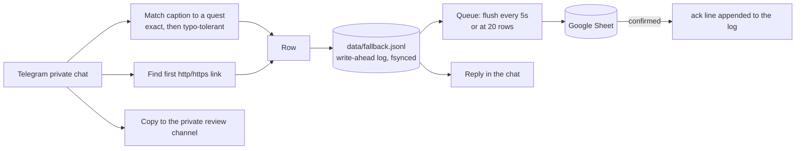

# quest-scribe

A Telegram bot that logs community quest submissions (screenshots and links) to a Google Sheet, with a local write-ahead log so nothing is lost.

[](https://github.com/tahabakri/quest-scribe/actions/workflows/ci.yml)

Members link their account ID once in the separate campaign bot, then send proof of completed tasks to this bot, in a private chat or in your community group: a screenshot with the quest name as the caption ("daily check-in"), or a link to something they made. quest-scribe turns every submission into a spreadsheet row that a human can review, and keeps a copy of the evidence in a private channel. It has no binding of its own and never reads the campaign bot's data.

It is the Telegram half of a pair. Its sibling, [quest-ledger](https://github.com/tahabakri/quest-ledger), does the same on Discord, and both write to the **same sheet** with the same columns, so one campaign can run on both platforms. Either works alone.

## What it is, and what it isn't

**It is a data-capture layer.** It records who submitted what, when and where, matches the caption to a quest type, and flags anything that needs a human look: typos and unrecognised captions.

**It is not a scoring engine.** It does not award points, show leaderboards, or verify that a task really happened. Verification usually needs data the bot can't see (your product's backend, a partner's records), so it is left to the reviewers working from the sheet.

## How it works



1. **A member links their ID elsewhere.** Once, in the campaign bot. This bot has no `/bind` and cannot see who has linked what, so every row it writes has `uid` blank and `bound = FALSE` (here, "not checked by this bot"). The Telegram user ID is saved in `user_id`.
2. **A member submits.** A photo (or an image sent as a file) with a caption is logged, and the caption is matched to a quest keyword. A message with a link and no image is logged as the link quest.
3. **Every row is made durable first.** It is appended and fsynced to `data/fallback.jsonl` before the bot replies, and before any Sheets call. "Logged" therefore always means the row is saved.
4. **Rows reach the sheet in batches.** Once the sheet confirms, an `ack` line goes into the log. Anything never acknowledged is replayed on the next start.

### What the bot does with each message

Members can submit in a **private chat** with the bot, or **in your community group**, where everyone can see the entries. In the group the bot reads only the group(s) you list in `TG_GROUP_IDS`, reacts only to a photo (or a quest name posted without one), replies to that very message, and stays silent on ordinary chat, commands and bare links, so the group stays readable. Any other group is ignored. In a private chat it also answers `/start` and `/help`, and logs a message with a link as a content submission. Promote the bot in your group with a link button to `https://t.me/<BotUsername>?start=quests`.

| Member sends | Row logged | Reply |
|---|---|---|
| `/start`, `/help` | none | the welcome text, which tells members to link their ID once in the campaign bot first; `/help` adds the quest names |
| photo (or an image sent as a file) + a caption matching a quest | the quest type | "Logged: <quest name>" |
| the same with a typo, or a close variant | the quest type, `fuzzy_match = TRUE` | the same |
| photo + a caption matching nothing | `unmatched`, caption kept | "saved for review" |
| photo with no caption | `unmatched` | "saved; add the quest name next time" |
| a quest name, no image | none | asks for a screenshot |
| a message with a link and no image | the `telegram.link_quest_type` | "Logged your link" |
| anything else | none | the help text |

- **Albums.** Several photos sent at once arrive as separate messages. They are gathered for about two seconds and logged as **one** row, using the caption from whichever photo has it and the first photo as the evidence. A photo that turns up after its album was logged is not a second submission: it is copied to the review channel only.
- **Evidence stays private.** Every submission is copied into a private **review channel** (`TG_REVIEW_CHANNEL_ID`), with the member's ID, handle, bound ID and quest type as its caption. The row's `message_link` points at that copy, and `attachment_url` holds Telegram's `file_id`. The bot never stores or logs a file download URL: it contains the bot token, and whoever has the token controls the bot. As a second layer, anything that looks like a token is masked in every log line.
- **Nothing is lost to a Telegram hiccup.** If the review copy fails, the row is still logged, with a placeholder link that can't be opened (and an error in the log). Replies are retried briefly after a network or server error and then given up on; a reply that can't be sent never blocks the messages behind it, and never affects the row.
- **Downtime.** Telegram keeps messages for a while (about a day) while the bot is offline, and delivers them when it comes back.
- **A refused token** (revoked, or the bot was deleted) stops the bot with a message that says what to fix. An unreachable Telegram, or a second copy of the bot polling with the same token, is logged and retried.

### Closing the campaign

Set `CAMPAIGN_END_UTC` (for example `2026-11-22T23:59:59Z`, UTC written out explicitly) and, from that moment, submissions are answered with `replies.ended` instead of being logged. The moment the member **sent** the message counts, not the moment it was processed, so a message sent in time but delivered after downtime is still logged. `/start`, `/help` and plain chat give the same "ended" reply instead of inviting more submissions.

### Caption matching

Captions and keywords are compared in a canonical form: Unicode-normalised, lower-case, with punctuation, emoji and repeated spaces collapsed. So `**Share-Post** ✅`, `share post` and `SHARE   POST` are the same.

1. **Exact.** The keyword appears anywhere in the caption. Longer keywords are checked first, so a specific keyword always wins over a shorter one it shares words with.
2. **Typo-tolerant.** If nothing matches exactly, each run of caption words is scored against each keyword by [Levenshtein ratio](https://en.wikipedia.org/wiki/Levenshtein_distance): `1 - edits / length of the longer string`. Windows one word shorter or longer than the keyword are scored too, so merged or split words still count. The best score at or above `fuzzy_threshold` (default 0.8) wins; ties go to the longer keyword. Those rows get `fuzzy_match = TRUE`. For example, `done - event attendence ✅` scores 0.94 against `event attendance`.
3. **Specificity guard.** If the exact hit is a keyword contained in a longer keyword (`check-in` inside `daily check-in`), and the caption is a close typo of the longer one (`daly check-in`), the longer one wins, flagged fuzzy. A typo therefore never silently downgrades a submission to a less specific quest.

Typo matching has a limit: `sharing post` is only 0.75 similar to `share post`, below the 0.8 default. List such variants as extra keywords with `review: true` and they are logged under the right quest and flagged, so a person can confirm them from the sheet.

A keyword marked `strict` skips the typo step and only counts as a whole word. That keeps a short keyword like `join` from matching `joint`, `joined` or `disjoin`. Pair it with a longer, non-strict alias (`join event`) so typos of the full name still match.

Anything that clears none of these is logged as `unmatched` with its full text. Nothing is lost to a typo, and reviewers decide.

### Reliability

- **Write-ahead log.** Every row is appended and fsynced to `DATA_DIR/fallback.jsonl` before any Sheets call. The file is append-only JSON Lines: rows and `ack` lines, never edited in place. A crash can at worst tear the final line, which is skipped on the next start.
- **Batching.** Rows are sent every 5 seconds or as soon as 20 are waiting, one `values.append` per tab. This stays far below the Sheets write quota during launch-day bursts.
- **Retries.** A failed batch is retried after 1s, 4s and 16s. If Sheets is still down, the rows stay queued (and in the log). The writer pauses for 30 seconds to 5 minutes, then tries again. Nothing is dropped, and the bot keeps accepting submissions.
- **No duplicates on replay.** A Sheets call that errors may still have been applied. So rows from a failed attempt, and rows restored from the log at startup, are first checked against the sheet's `message_link` column.
- **Isolation.** Every handler is wrapped in error handling, so one bad message never takes the bot down. A reply failure never affects the row. If the log itself can't be written, the row is printed to the host logs for manual recovery, and the member is told to try again.
- **Safe cells.** Values are written `RAW`. A caption such as `=IMPORTXML(...)` stays text instead of becoming a live formula in your reviewers' sheet, and long IDs are never rounded to floats.
- **One writer.** A lock file in `DATA_DIR` stops two copies of the bot, or the bot and `npm run replay`, from writing the same log.
- **Clean shutdown.** On `SIGTERM` the bot finishes any album still waiting, makes one last attempt to write queued rows, and exits, within 20 seconds at most.

## The sheet

Point the bot at any spreadsheet shared with its service account. It creates the two tabs, if missing, with these headers in row 1. The headers are re-checked before every batch:

- **Different headers**, for example a column inserted in the middle: the bot stops writing rather than put values under the wrong columns. Submissions keep landing in the log, and writing resumes once the sheet is fixed.
- **An older layout:** a sheet from before the `platform` column existed (identity columns named `discord_user_id` and `discord_username`) is upgraded by the bot itself: it rewrites row 1 and touches nothing else. It only does so when row 1 matches the old layout exactly and the cell where `platform` goes is empty. If a reviewer's own column sits there, the bot refuses rather than overwrite it, and says so in the log. Existing rows keep a blank platform, which reads as Discord.
- **A deleted tab:** it is recreated.

You can add your own review columns to the right of these.

**The layout is shared with [quest-ledger](https://github.com/tahabakri/quest-ledger).** When both bots write one sheet, each insists that row 1 matches exactly, so the two must agree. `test/sheet-layout-contract.test.ts` pins the columns in both repositories. If a column ever changes, change both in the same release and deploy the Discord bot first.

The `Binds` tab belongs to the Discord bot alone. quest-scribe never reads or writes it.

**`Submissions`**, one row per submission:

| Column | Header | Example | Notes |
|---|---|---|---|
| A | `timestamp_utc` | 2026-01-15T10:00:00Z | When the message was sent |
| B | `user_id` | 5000000001 | |
| C | `username` | @member_one | |
| D | `uid` | | Always blank from this bot: it cannot see the campaign bot's data |
| E | `bound` | FALSE | Always FALSE from this bot. It only means "not checked here" |
| F | `quest_type` | daily_check_in | A quest type, the link quest type, or `unmatched` |
| G | `fuzzy_match` | FALSE | TRUE for typo matches and for `review` keywords: filter on it for a manual check |
| H | `channel_name` | telegram_dm | Always `telegram_dm` from this bot |
| I | `message_text` | Daily check-in done ✅ | Full raw text or caption |
| J | `attachment_url` | AgACAgIAAxkB... | The first image's Telegram `file_id`; blank for links. Never a download URL |
| K | `link_url` | https://example.com/post/1 | First link; blank if none |
| L | `message_link` | https://t.me/c/1234567890/701 | The copy in the private review channel; also the dedupe key |
| M | `date_utc` | 2026-01-15 | Date only, handy for daily caps |
| N | `platform` | telegram | `discord` or `telegram` |

To count per member across platforms, match a Telegram `user_id` to the campaign bot's data outside this sheet: this bot does not know the member's `uid`.

> **Open `message_link`, not `attachment_url`.** The `file_id` is only meaningful to the bot that received it. The link opens the copy in the private review channel, where the screenshot always loads.

## Setup

You need Node.js 22.12 or newer, a Telegram account, and a Google account.

### 1. Telegram bot

1. In Telegram, open [@BotFather](https://t.me/BotFather), send `/newbot`, and choose a name and a username ending in `bot`. Copy the token into `TELEGRAM_BOT_TOKEN`. It is a password: whoever holds it controls the bot. Create the bot from an account your organisation owns, not a personal one, and never paste the token into chat, docs or screenshots.
2. Send BotFather `/setprivacy`, pick your bot, and choose **Disable**: with privacy mode on, a bot in a group only sees commands, not the photos members post. If you want submissions in the group, add the bot to the group, and put the group's ID (it starts with `-100`) in `TG_GROUP_IDS`. The bot sets its own command menu (`/start`, `/help`) at startup.
3. Create a **private channel** for evidence, and add the bot to it as an **administrator** with permission to post messages. Copy the channel's ID, which starts with `-100`, into `TG_REVIEW_CHANNEL_ID` (in Telegram Web it is in the address bar when the channel is open). Anyone who can read this channel sees every screenshot submitted, so add only the people who review them.

At startup the log says `connected to Telegram as @yourbot` and `review channel ready`, or says exactly what is wrong (a refused token, or a channel the bot can't post in). Telegram is polled over HTTPS: no public URL or webhook is needed.

### 2. Google service account

1. In the [Google Cloud Console](https://console.cloud.google.com/), create a project (or pick one) and enable the **Google Sheets API** under **APIs & Services > Library**.
2. Go to **IAM & Admin > Service Accounts > Create service account**. No roles are needed.
3. Open the account, then **Keys > Add key > Create new key > JSON**, and download it. Keep it private (`service-account*.json` is gitignored).
4. Create a Google Sheet. Click **Share** and add the service account's email (`name@project.iam.gserviceaccount.com`) as **Editor**.
5. Copy the spreadsheet ID, the part of the URL between `/d/` and `/edit`, into `GOOGLE_SHEET_ID`. The full URL works too.

If your Google Workspace blocks service-account key creation, an administrator has to allow it, or you can use a project under a personal account.

### 3. Configure and run locally

```bash
git clone https://github.com/tahabakri/quest-scribe.git
cd quest-scribe
npm ci
cp .env.example .env              # fill in the Telegram and Google values
cp config.example.yml config.yml  # set your quests and wording
npm run dev
```

The first start creates the sheet tabs, then logs `connected to Telegram`.

## Configuration

Everything deployment-specific lives in `config.yml`, which is gitignored. [`config.example.yml`](config.example.yml) is a commented template. On hosts without file mounts, put the whole YAML document in the `CONFIG_YAML` environment variable instead; it wins over the file. Any string value may reference an environment variable as `${NAME}`. The config is validated at startup: a typo, a missing field or a bad value stops the bot with a message naming every problem.

**One file for both bots.** The Discord bot ([quest-ledger](https://github.com/tahabakri/quest-ledger)) reads the same format, so the quest list can be written once. quest-scribe ignores what only Discord uses (`channels`, `reactions`, `warning_delete_after_seconds`, `replies.unmatched` / `no_image` / `unbound`, a quest's `reply`, and the whole `bind` section, `sheets.binds_tab` and `sheets.binds_refresh_minutes`), and drops those before `${VAR}` references are resolved, so variables only Discord needs can stay unset here.

| Key | Default | Meaning |
|---|---|---|
| `quests` | required | List of `{ keyword, type, name?, strict?, review? }`. `name` is what members see for the quest ("Logged: <name>"); it defaults to a readable form of `type`, and one quest type has one name. `review: true` marks a keyword as a close variant rather than the official caption (a quest's name, an "-ing" form that typo matching is too far from): it logs under the quest like any match but sets `fuzzy_match = TRUE`, unless the official caption is in the text too. `type` is what lands in `quest_type`. Several keywords may share one type (aliases). Keywords must stay distinct after normalisation; `unmatched` is reserved. `strict: true` matches the keyword only as a whole word, with no typo tolerance: use it for short keywords such as `join`, which would otherwise match inside `joint`. |
| `fuzzy_threshold` | `0.8` | Minimum Levenshtein ratio for a typo match, `0 < t <= 1`. `1` disables typo matching. |
| `replies.ended` | a generic sentence | Sent instead of logging for a submission sent after `CAMPAIGN_END_UTC`, and by `/start`, `/help` and plain chat once the campaign is over. |
| `telegram.welcome` | a generic welcome | The `/start` text. `/help` sends it plus the list of quest names (the first keyword of each quest that is not a `review` variant, in config order). The two together must fit one Telegram message (4096 characters). |
| `telegram.help_quests_heading` | a generic heading | The line above the quest names in `/help`. |
| `telegram.link_quest_type` | `content_link` | `quest_type` for a message with a link and no image. |
| `telegram.replies.*` | generic sentences | `logged` (`{quest}` becomes the quest's name), `unmatched`, `no_caption`, `no_image`, `ugc_logged`, `error`. Plain text, no formatting. |
| `image_extensions` | `[png, jpg, jpeg, gif, webp]` | File types that count as a screenshot when sent as a file. |
| `sheets.submissions_tab` | `Submissions` | Tab name. |
| `sheets.flush_interval_seconds` | `5` | Send queued rows at least this often... |
| `sheets.flush_max_rows` | `20` | ...or as soon as this many are waiting. |

### Environment variables

| Variable | Required | Meaning |
|---|---|---|
| `TELEGRAM_BOT_TOKEN` | yes | Token from @BotFather. |
| `TG_REVIEW_CHANNEL_ID` | yes | The private evidence channel, starting with `-100`. |
| `TG_GROUP_IDS` | no | Community group(s) where members post submissions in the group itself: IDs starting with `-100`, separated by commas. Without it the bot works in private chats only. |
| `CAMPAIGN_END_UTC` | no | When submissions close, as UTC with a `Z`: `2026-11-22T23:59:59Z`. See [Closing the campaign](#closing-the-campaign). |
| `TELEGRAM_API_ROOT` | no | Only for a self-hosted Bot API server, for example `http://localhost:8081`. |
| `GOOGLE_SHEET_ID` | yes | Spreadsheet ID or URL. |
| `GOOGLE_SERVICE_ACCOUNT_JSON` | yes | The key JSON itself (on one line, unquoted, in a `.env` file) or a path to the key file. |
| `DATA_DIR` | no, default `data` | Where the write-ahead log lives. **Must be persistent storage in production.** |
| `CONFIG_PATH` | no, default `config.yml` | Config file location. |
| `CONFIG_YAML` | no | The whole config as YAML; overrides the file. |
| `LOG_LEVEL` | no, default `info` | `debug`, `info`, `warn` or `error`. |
| anything your config references | if referenced | |

## Deploying as a worker

quest-scribe is a long-running worker: it serves no HTTP and needs no public URL. Any host that keeps a Node 22+ process running, restarts it on crash, and gives it **persistent disk** will do.

**The persistent disk is not optional.** The write-ahead log is what makes a Sheets outage or a crash survivable. On hosts with ephemeral filesystems, Railway included, a redeploy wipes the container's disk. Rows that were accepted but not yet written would be lost with it. Put `DATA_DIR` on a mounted volume.

### Railway

1. **New Project > Deploy from GitHub repo**, and pick your fork. Railway's builder detects Node (version from `engines`), installs dependencies, runs `npm run build`, and starts with `npm start`.
2. **Add a volume** to the service, mounted at `/data`.
3. **Variables:** set `TELEGRAM_BOT_TOKEN`, `TG_REVIEW_CHANNEL_ID`, `GOOGLE_SHEET_ID`, `GOOGLE_SERVICE_ACCOUNT_JSON` (paste the key JSON), `CONFIG_YAML` (paste your config), `DATA_DIR=/data`, optionally `CAMPAIGN_END_UTC`, and any variables your config references.
4. **Settings:** set `RAILWAY_DEPLOYMENT_DRAINING_SECONDS=25`. Railway's default is 0, which sends SIGKILL right after SIGTERM on every redeploy, so the clean shutdown (finishing an album, one last write to the sheet) never gets to run; queued rows stay safe in the write-ahead log either way, but this closes the small gap. The bot leaves on its own within 20 seconds. Don't generate a domain. The default restart policy (On Failure) restarts the bot after a crash; on paid plans you can raise its 10-restart limit. Replicas can't be combined with volumes, which suits the bot: two Telegram pollers with one token fight each other.
5. **Deploy**, then watch the logs for `connected to Telegram` and `review channel ready`.

**Next to the Discord bot.** Put both in **one Railway project**, one service per repository, each with its **own volume** (a volume belongs to one service). The values both need (`GOOGLE_SHEET_ID`, `GOOGLE_SERVICE_ACCOUNT_JSON`, `CAMPAIGN_END_UTC`, and `CONFIG_YAML` if you share one config) can be defined once as project-level **Shared Variables** (Project Settings > Shared Variables) and shared with both services. If the sheet still has the older layout, deploy the Discord bot first: it upgrades the headers, and a bot on the old code would stop writing once they change.

With a volume attached, Railway stops the old deployment before starting the new one, so every redeploy has a short gap. Telegram keeps messages sent in the gap and delivers them when the bot is back.

### Other hosts

On a VPS, run `npm ci && npm run build`, then keep `npm start` alive with systemd (`Restart=on-failure`), pm2 or similar, with `DATA_DIR` on a normal disk. Send `SIGTERM` to stop.

## Replaying the log

The bot replays automatically: on every start, rows the log never saw acknowledged are checked against the sheet and written if missing. Restarting the bot is therefore the usual fix after an outage.

To replay by hand, for example from a copy of the log on another machine:

```bash
npm run build
npm run replay -- --dry-run                       # list what would be written
npm run replay                                    # write it
npm run replay -- --file ./backup/fallback.jsonl  # replay another copy
```

Stop the bot first. The data-dir lock refuses to replay while a bot on the same machine is running, because two writers would duplicate rows. Replay exits non-zero if anything is left unwritten, so you can rerun it once Sheets is reachable.

`fallback.jsonl` is plain JSON Lines, one object per line: a `row` line (keys match the sheet headers) or an `ack` line listing the row IDs that reached the sheet. You can also inspect it with `jq`, or import it by hand.

## Development

```bash
npm run dev        # run from source, restart on change
npm test           # unit tests (Vitest)
npm run lint       # ESLint, type-aware
npm run typecheck  # tsc --noEmit
npm run build      # compile to dist/
```

```
src/
  index.ts                  wiring: config, log, writer, Telegram, shutdown
  config.ts                 zod schema, CONFIG_YAML / file loading, ${VAR} interpolation
  env.ts                    environment variables and service-account parsing
  matcher.ts                caption normalisation, exact and fuzzy quest matching
  quests.ts                 quest display names and the /help list
  campaign.ts               the end-date check
  submissions.ts            per-message decision table, row building, link and image detection
  wal.ts                    append-only write-ahead log
  writer.ts                 batching, retries, dedupe
  supervise.ts              starts the bot in the background and retries a passing failure
  lock.ts                   data-dir lock
  replay.ts                 npm run replay
  sheets/                   column schema (and older layouts) and the Google Sheets gateway
  telegram/                 service (all the behaviour), grammY adapter, message mapping,
                            album collector, command and link parsing
test/                       Vitest suites, an in-memory fake sheet, and a fake Telegram Bot API
                            that the real grammY adapter runs against
```

## License

[MIT](LICENSE) © Taha Bakri
